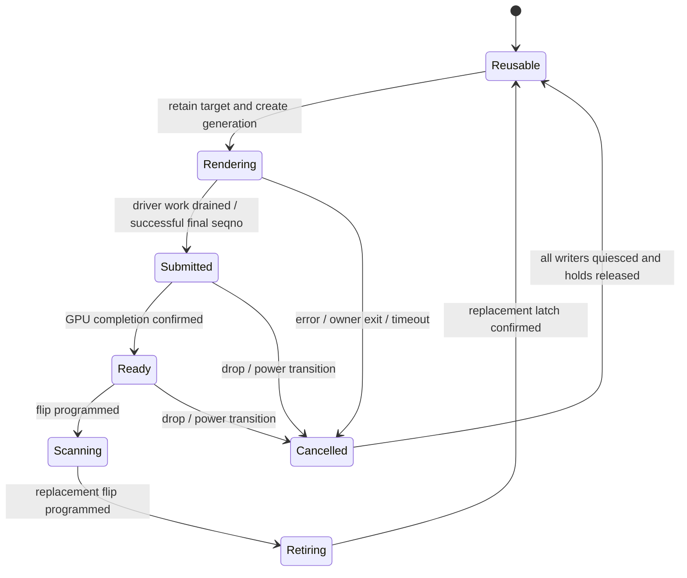

# Task 16 plan: pipelined rendering and presentation

Working plan for [PERF-TASKS](PERF-TASKS.md) task 16, written 2026-10-25 after the
task-5 threaded context ([report](PERF-TASK5-THREADED-20261025.md)) made the
per-frame `glFinish` the largest wait on CoreAnimation's display thread.
**Status: S0-S3 complete (2026-10-25); S4 design review next. G1 remains open (conditional S2 feasibility).**
Nothing here is measured yet unless a step's result says so.

**How to use this file.** Each step below is sized for one agent. Take the next
step whose dependencies are done, set its tracker row to `in progress` with your
name and the clock time, and on finishing fill in the result line (commits, CI
run IDs, capture directories, numbers) and set it to `done`. A step that disproves
the plan's premise sets the gate it feeds to `fail` and stops; do not work around
a failed gate without the user. Read [For every agent](PERF-TASKS.md#for-every-agent)
first: phone lock, battery check, accessory-sync precheck, ground rules, and
"done means on the phone".

## Tracker

| Step | Work | Needs | Phone | Status | Owner / result |
| --- | --- | --- | --- | --- | --- |
| [S0](#s0-establish-the-baseline-and-bases) | Establish the baseline, source bases and patch number | — | read-only | done | Codex, 2026-10-25 15:01 Budapest; installed SHA256 `14e32aea4121e9c8a357da8f5e6322fe572a85f1c22e496990af0e687cb19261`; slot b recorded j0070; base `bfb61629aa90e9e44d85ea929ddffbe6a5a78222`, `/home/teleg/xnu-t16` (`t16`); j0100 reserved. See S0 result. |
| [S1](#s1-critical-path-budget-from-existing-captures) | Critical-path budget from existing captures | S0 | no | done | Codex, 2026-10-25 15:14 Budapest; `research/t16/budget.py`, `budget.json`, `stacks.txt`; CC A flush drain + GPU wait 19.16 ms/arrival (36.8% occupancy), Home A 29.37 ms (52.3%). B/repeat unsampled. See S1 result. No new CI/boot. |
| [S2](#s2-how-coreanimation-uses-its-swap-surfaces) | How CoreAnimation uses its swap surfaces | — | no | done | Codex, 2026-10-25 15:26 Budapest; three page records, dynamic Buffer allocation; third surface conditional on availability policy. 9,916 instruction and eight vtable checks pass. See S2 result; no CI/boot. |
| [S3](#s3-surface-lifecycle-audit-and-invariants) | Surface lifecycle audit and invariants | — | no | done | Codex, 2026-10-25 16:37 Budapest; kernel + pristine patched Mesa lifecycle audit; 51 source files inventoried, four patches apply, wrapper sources match. See S3 result. No CI/boot. |
| [G1](#gates) | Gate: is there enough overlap to win? | S1, S2 | — | open | (a) supported by saved fix+dump capture, with final-library equivalence caveat; (b) S2 found conditional third-buffer feasibility; current-workload private flags/cooldown unverified. Resolve in S3/S4 before implementation. |
| [S4](#s4-design-review) | Design review with the user | G1, S3 | no | todo | |
| [S5](#s5-kernel-sleep-instead-of-spin-in-the-present-path) | Kernel: sleep instead of spin in the present path | S0, S3 | yes | todo | |
| [S6](#s6-kernel-render-tickets) | Kernel: render tickets (surface pending/ready) | S4 | — | todo | |
| [S7](#s7-kernel-present-queue) | Kernel: present queue, SwapWait on flip | S4, S6 | — | todo | |
| [S8](#s8-neutral-boot-of-the-new-kernel) | Neutral boot: new kernel, old library | S5-S7 | yes | todo | |
| [S9](#s9-libsweetca-mode-1-flush-and-submit-no-gpu-wait) | libsweetca mode 1: flush + submit, no GPU wait | S8 | yes | todo | |
| [S10](#s10-libsweetca-mode-2-no-driver-drain) | libsweetca mode 2: no driver drain (tickets) | S9 | yes | todo | |
| [G2](#gates) | Gate: do modes 1/2 gain without regressions? | S9, S10 | — | open | |
| [S11](#s11-conditional-remove-the-swap-surface-limit) | Conditional: remove the swap-surface limit | G2 + S2 | yes | todo | |
| [S12](#s12-matched-validation) | Matched validation, sustained run, user's look | G2 | yes | todo | |
| [S13](#s13-make-it-the-default) | Make it the default, slot b, docs | S12 | yes | todo | |

S1, S2, S3 and S5 can run in parallel (S5 is independent of the queue design and
worth having even if G1 fails). S6 and S7 share `SweetFramebuffer.cpp`/`SweetGPU.cpp`:
one agent, or strictly one after the other.

## What the investigation found (2026-10-25)

### Today's frame on the display thread

1. CA draws through libsweetca. Every 32 draws `kick_after_draw` has the driver
   thread (`gdrv0`, Mesa's threaded context) flush and send Mesa's deferred submits
   to the kernel ([sweetca.c `kick_after_draw`](../mesa/darwin/sweetgl/sweetca.c),
   `sgl_kick` in [sweetgl.c](../mesa/darwin/sweetgl/sweetgl.c)).
2. CA calls flush. `w_Flush` writes shadow targets back and calls **`glFinish()`**:
   the display thread waits for `gdrv0` to drain its queue and submit (the
   "driver drain"), then for the GPU fence ([sweetca.c `w_Flush`](../mesa/darwin/sweetgl/sweetca.c)).
3. CA calls `IOMobileFramebufferSwapEnd` (selector 5). With `sweetfb_sync=1` (the
   default since j0056) the kernel's `AppleCLCD::swap()` runs on CA's thread: it
   **spins** (`IODelay(100)`, up to 25 ms) until the previous flip latched, then
   `present()` -> `directPresent()` -> `sweet_surface_cpu_access()` waits for the
   surface's last GPU job (j0055 `gpuSeqno`, ~0 today because of `glFinish`) and
   `scanScaled()` programs VIG0 (j0058). Hold sets rotate (`fShowHold` ->
   `fRetireHold`), `noteShown()` records the swap as ended.
4. CA's `IOMFBDisplay::can_update_` polls `SwapWait(N)` before drawing into swap N's
   surface again. j0058's rule (`sweetfb_swapwait=1`): N is done once a *later swap
   ended*. A GPU submit writing a surface that is still retiring (later frame
   flipped, not latched) waits in the submit ioctl for the latch, **spinning** up
   to 50 ms (`sweet_fb_gpu_write_wait`).

Sources: [j0055](../xnu/patches/j0055-jasmine-display-waits-for-gpu.patch),
[j0058](../xnu/patches/j0058-jasmine-display-scale.patch), current kernel source
`~/xnu-wifi` (WSL) `iokit/Kernel/arm/SweetFramebuffer.cpp` (`swap`, `showDirect`,
`presenter`, `swapWait`, `retireLatched`, `sweet_fb_gpu_write_wait`).

### The wait budget (threaded2 capture, Control Center A, 4 s CPU window)

From [the threaded-context report](PERF-TASK5-THREADED-20261025.md), about 77 swap
arrivals in the window, 53 ms median interval:

| Display thread, per arrival | ms |
| --- | ---: |
| On CPU (CA + GL validation) | ~22.9 |
| GPU fence wait in `glFinish` | ~10.5 |
| Driver-thread drain in `glFinish` | ~9.1 |
| Runnable, waiting for a CPU | ~6.4 |
| Rest (SwapEnd, run loop) | ~4 |
| `gdrv0` on CPU, per arrival | ~17.7 |

If presentation no longer blocked the display thread, the frame would be bounded by
max(CA thread CPU ~23, `gdrv0` ~18, GPU time per frame, panel period) instead of
their partial sum. **That is a ceiling of roughly 25-30 ms against 53 ms in Control
Center, not a prediction**: GPU time per frame is not measured (only the residual
fence wait is), the swap-surface limit below may serialize the frames anyway, and
Home already showed 765 ms/4 s runnable time, so more concurrency can turn into CPU
contention on the 4 Gold cores.

### Constraints the design must handle

- **C1. Ordering.** With the threaded context and merged submits, when CA's thread
  leaves `w_Flush` without waiting, the frame's last submit may not have reached the
  kernel yet. The surface's `gpuSeqno` then names an earlier kick's job, and
  `present()` or another process's `IOSurfaceLock` would read unfinished pixels.
  Replacing `glFinish` with `glFlush` alone is wrong, not merely slow.
- **C2. Two swap surfaces and SwapWait.** CA draws into two swap surfaces (ids 2
  and 4, GPU.md "The flicker found"). If SwapEnd returns before the flip, "a later
  swap ended" no longer means the earlier surface left the panel: CA would draw into
  the surface on the panel, and `sweet_fb_gpu_write_wait` returns at once for a
  *shown* (not retiring) surface. SwapWait must become "a later swap's flip was
  programmed". With two surfaces CA may then have to wait for frame N's GPU work
  before it starts N+1, which removes most of the overlap unless CA prepares N+1
  before it needs the surface. Unknown: S2 answers it.
- **C3. Write-wait on the driver thread.** Since task 5, GPU submits run on
  `gdrv0`; `sweet_fb_gpu_write_wait` now stalls the driver thread (and spins a core)
  until the latch.
- **C4. Spinning.** `swap()`, `showDirect()` and the write-wait poll the MDP's
  CTL_FLUSH bits with `IODelay(100)`; GPU completion is polled too (`sweet_gpu_wait`,
  `delay(50)`; no GPU interrupt is used). On a CPU-bound 4-core system a spinning
  kernel thread costs render time.
- **C5. The old presenter thread.** `sweetfb_sync=0` still starts a kernel presenter
  thread with a two-deep queue (`fQRec`, `presenter()`, `showDirect()`). It predates
  j0058's retire logic and spins for the latch; useful as a starting point, not
  usable as it is.
- **C6. Latch signal.** jasmine has no physical frame counter mapping (`fIntf1` is
  null, topaz-only); the latch is seen only by polling CTL_FLUSH, with a 50 ms
  timeout fallback (framebench events 14/15). Correctness of the new SwapWait rests
  on this signal; zero 50 ms fallbacks were seen in the first framebench session.
- **C7. GPU completion time.** Framebench event 21 records when someone *observed*
  the fence, not when the GPU finished, so GPU time per frame is not measured.
- **C8. Genuine waits stay.** `w_Finish`, `w_FinishObjectAPPLE`, `glReadPixels`,
  shadow write-back and CPU locks must keep their full semantics.
- **C9. Sources and numbers.** `~/xnu-8796` `jasmine-merge` is at j0070; the newest
  kernel line is `~/xnu-wifi` (`wifi`, j0071-j0099) plus framebench (`codex/framebench`,
  also numbered j0099). The patch number j0099 is used twice. Assign task 16's patch
  only after S0 checks every branch; the next free number is at least j0100.

## Proposed design (to be confirmed in S4)

**Surface states:** free -> rendering (CA's GL work queued) -> submitted (last job's
seqno known) -> queued for present -> scanning (on the panel) -> retiring (later
flip programmed, not latched) -> free.

**Invariants** (S3 makes this list complete and checks the code against it):

1. Never program a flip to a surface whose frame is not fully submitted and complete.
2. Never let the GPU write a surface that is scanning or retiring.
3. `SwapWait(N)` is done only when a later swap's flip has been programmed.
4. A surface is held until it is free (no reuse, no free, no pool give-back earlier).
5. CPU readers (`IOSurfaceLock` without AvoidSync, display copies) wait for pending
   *and* submitted work.
6. The queue holds at most one frame beyond the one scanning (bounded latency); a
   frame whose ticket times out is dropped, never shown, and counted.
7. Every wait sleeps; none spins longer than a few microseconds.
8. Both modes switch off at runtime-free cost: kernel boot-arg and libsweetca env.

**Mechanism:**

- **Kernel present queue** (`sweetfb_queue=1`): SwapEnd takes holds, enqueues the
  record and returns. A presenter thread sleeps until the queued frame's surface is
  ready (ticket cleared, `gpuSeqno` complete) and the previous flip latched, then
  programs the flip and rotates the j0058 hold sets; `noteShown` moves to that point.
  Wakeups come from the submit and completion paths, or a short sleep while polling
  CTL_FLUSH; a GPU completion interrupt is an optional later improvement.
- **Render tickets** (two new SweetGPU user-client selectors): on CA's thread,
  `w_Flush` marks the target surface *pending* (one cheap call, before SwapEnd can
  happen); a driver-thread callback queued after the flush sends the deferred submits
  (as `sgl_kick_driver`) and then marks the surface *ready at the client's last
  submitted seqno*. This fixes C1 without waiting on CA's thread and without
  interposing CoreAnimation's IOMobileFramebuffer calls.
- **libsweetca modes** (`SWEETCA_PIPELINE`): 0 = today (`glFinish`); 1 = flush and
  wait only until the frame is submitted (driver drain, no GPU wait; no tickets
  needed); 2 = tickets, no drain wait. Mode 1 is the safe first step and isolates
  how much of the gain is GPU overlap versus driver overlap.

Rejected for now: interposing `IOMobileFramebufferSwapEnd` so the driver thread
calls it (shared-cache calls may not be interposable, and SwapEnd's caller-visible
results would change); a blind `glFinish` -> `glFlush` swap (C1); a larger
batch-cache or timeout instead of ordering.

## Gates

- **G1 (after S1 + S2):** proceed to implementation only if (a) the display
  thread's GPU-fence + drain wait is still a large share of the frame on the current
  library, and (b) S2 shows CA can do useful frame work before it needs the next
  swap surface, *or* that a third swap surface is achievable. If only (a) holds,
  re-scope around S11 with the user. If (a) fails, stop and report; S5 still stands
  on its own.
- **G2 (after S9 + S10):** at least one mode shows shorter presentation intervals
  in matched captures with zero new held draws, no dropped-frame storm and bounded
  queue latency. Otherwise record the result and stop; do not install.

## Steps

### S0. Establish the baseline and bases

**Goal:** everyone works from the same facts.

- Record the installed libsweetca hash (expected `14e32aea…`, Mesa CI `40170072509`,
  threaded context + leak fix) by read-only retrieval, and which image slot b runs
  (NOTES.md "Slot b = iOS"; the framebench99 image was booted temporarily).
- Decide the kernel source base for task 16 (expected: `wifi` `f7c66dd` + framebench
  j0099 from `codex/framebench`) and create a worktree
  (`git -C ~/xnu-8796 worktree add ~/xnu-t16 -b t16 <base>`).
- List every `jasmine-jNNNN` on all branches and in `xnu/patches/`; reserve the first
  free number for task 16 in PERF-TASKS and here (j0099's double use is noted in C9).
- Confirm `topaz_surface_drawn()` returns at once on jasmine (`gGPULock` null?).

**Done when:** this file's S0 row holds the hashes, base commit, worktree path and
the reserved number. No boot needed beyond the read-only check.

### S1. Critical-path budget from existing captures

**Goal:** a per-frame budget for the current library, offline.

- Inputs: `research/framebench/20261025-threaded2/` and the matching symbols; if
  the installed final library differs from the fix+dump build used there, say so.
- Per swap arrival in each usable segment (CC A/B, Home A/B, Spotlight repeat): the
  display thread's CPU, driver drain, GPU fence wait, time inside SwapEnd (events
  11->12), SwapWait polls that found "not done" (event 18), runnable time; `gdrv0`'s
  CPU and its time in `sweet_fb_gpu_write_wait` (event 19); GPU job submit->observed
  completion (events 20/21, labelled as an upper bound per C7).
- The overlap ceiling per segment as in the table above, with its assumptions.

**Deliverable:** a section "S1 result" appended to this file (tables, script path
under `research/t16/`). **Done when:** G1(a) can be answered with numbers.

### S2. How CoreAnimation uses its swap surfaces

**Goal:** know whether CA can overlap frame N+1's work with frame N's presentation.
Offline, in the iOS 16 shared cache (QuartzCore, IOMobileFramebuffer), using the
existing `ipsw` workflow (NOTES.md "GUI path research").

- How many swap surfaces `IOMFBDisplay`/`CA::WindowServer` allocate, and what sets the
  count (a framebuffer property, a default, the swap queue depth).
- In a frame: which CPU work (layer tree commit, preparation, offscreen passes)
  happens before CA checks `can_update_` and binds the swap surface; what CA does
  when `can_update_` says no (skip the tick, retry, block).
- What SwapEnd's caller uses from the call (return value, out data) and how SwapBegin
  IDs relate to SwapWait IDs (our "never begun" branch in `swapWait`).

**Deliverable:** "S2 result" section with symbol names/addresses and the answer to
G1(b). No phone.

### S3. Surface lifecycle audit and invariants

**Goal:** the complete state machine and hazard list before code changes. Offline.

- Kernel: every place that sets/clears `fPendHold`, `fShowHold`, `fRetireHold`,
  `fQHeld`, `gpuSeqno`, `drawn`, pool take/give and `sweet_hold`; the sync and
  presenter paths; `swapWait`; `sweet_fb_gpu_write_wait`; IOSurfaceLock;
  what happens on power-off, console takeover, panic and multi-layer (composeFit)
  frames.
- Mesa/libsweetca: TC flush paths (`PIPE_FLUSH_ASYNC`, fences, `callback`), when
  darwin's merged submits reach the kernel, the kick, shadow write-back, readbacks,
  and which IOSurface is the frame's target at `w_Flush` (needed for tickets).
- Interactions: task 14's selector-2 buffer-free freeze (longer holds), task 5's
  batch/fence leak fix (fences outliving batches).

**Deliverable:** "S3 result" section: state diagram, the invariant list checked
against code (file:function for each), hazards with the mechanism that covers them.

### S4. Design review

Update "Proposed design" from S1-S3 (queue depth, ticket calls, SwapWait rule,
write-wait handling, timeouts, counters, boot-args/env names, framebench events for
ticket/queue/flip). Write the test plan for S8-S12 with the risk of hangs stated.
**Done when:** the user approves the design in chat (quote and time in the row).

### S5. Kernel: sleep instead of spin in the present path

**Independent of the queue; may ship on its own.** Replace the CTL_FLUSH spins in
`swap()`/`showDirect()` and the 100 us spin in `sweet_fb_gpu_write_wait` with
sleeping waits (short `assert_wait_deadline`/`IOSleep`-style waits, or a wakeup from
the vsync/latch timer), keeping every timeout and the j0058 semantics. Add counters
for time slept versus spun. Measure: one framebench capture before/after on the same
day (after the precheck), plus held draws and the SWEET FB 600-frame line.
**Done when:** CPU time in those paths is gone from the profile, no new held draws,
no flicker by the user's eye; then it rides along with S13 (or is installed earlier
if the user wants it alone).

### S6. Kernel: render tickets

Two SweetGPU user-client selectors: *pending(surface id)* and *ready(surface id)*,
the latter setting `gpuSeqno` to the calling client's last submitted seqno and
clearing pending; a generation counter so a stale ready cannot clear a newer pending.
`sweet_surface_cpu_access` and `directPresent` wait for pending to clear (bounded;
timeout logged and counted, never shows the frame). Framebench events for both.
Unused by today's library, so behavior-neutral. Build on CI in the S0 worktree.

### S7. Kernel: present queue

`sweetfb_queue=1` (default 0 in this step): SwapEnd enqueues (depth 1 beyond the
frame on the panel, blocking SwapEnd only when full), the presenter waits as in the
design, programs the flip, rotates holds as j0058 does, calls `noteShown` at the
flip; SwapWait done only after a later flip was programmed; ticket timeout drops the
frame and releases its holds. Counters: queue depth, SwapEnd->flip and flip->latch
times, drops, write-waits. Same CI build as S6 if done by one agent.

### S8. Neutral boot of the new kernel

Test kernel (`fastboot boot`) with S5-S7, today's library (`glFinish` on), first
`sweetfb_queue=0` then `=1`. Expected: no change in arrivals/intervals beyond noise,
zero held draws, no drops, no flicker, no hang over a 10-minute uiround series.
Say before the round that it may hang (`sweetwdt=20`). **Done when:** both settings
are neutral; any difference is explained before S9.

### S9. libsweetca mode 1: flush and submit, no GPU wait

`SWEETCA_PIPELINE=1`: `w_Flush` keeps shadow write-back, then flushes and waits only
until the frame's submits are in the kernel (driver-thread callback + fence check, no
GPU wait). Requires `sweetfb_queue=1`. Mesa CI, `sweetgpu_gltest` 7/7, install as a
test library (keep the rollback copy), one framebench capture against S8's
queue-on baseline. Watch held draws, ticket/queue counters and the user's eye.

### S10. libsweetca mode 2: no driver drain

`SWEETCA_PIPELINE=2`: pending call on CA's thread in `w_Flush`, ready call from a
driver-thread callback after the kick; CA's thread does not wait for the drain.
Same tests as S9, plus a CPU-reader test: IOSurfaceLock of the swap surface from
another process right after a flush (`sweet_shot` or a small test) must see the
finished frame.

### S11. Conditional: remove the swap-surface limit

Only if S2 and G2 show that two swap surfaces serialize the frames or that
write-waits dominate `gdrv0`. Options to scope with the user: a third swap surface
(if S2 found the switch), or a GPU-side wait (the submit carries a wait on a latch
counter that the presenter writes, instead of blocking the ioctl). Separate design
note and approval; do not start it from this plan alone.

### S12. Matched validation

On one settled boot per variant (accessory-sync precheck), two framebench captures
each: baseline (queue off, mode 0), and the winning mode. Report presentation
intervals (median, p95, p99), arrivals and CTL-clear rates, SwapBegin->latch and
SwapEnd->flip latency, queue depth, drops, held draws, CPU per arrival on both render
threads, and spin/sleep counters. Label swap arrivals and CTL clears as proxies (C6).
Then a 10-minute uiround series without a hang, GL and CA tree tests (the known
image-orientation mismatch is pre-existing), and the user's visual check.

### S13. Make it the default

Kernel defaults (`sweetfb_queue=1` or no boot-arg needed), libsweetca default mode,
the patch exported as the reserved `jNNNN`, cherry-picked onto the kernel line slot b
uses, slot b image rebuilt and flashed per "Done means on the phone", first boot
checked, then NOTES.md "Slot b = iOS", GPU.md (baseline and result) and PERF-TASKS
task 16 updated. Keep the env/boot-arg switches as the rollback path.

## Risks and rollback

- **Flicker or torn frames** if an invariant is wrong: held-draw counter, user's eye;
  rollback `sweetfb_queue=0` / `SWEETCA_PIPELINE=0`.
- **Hangs** from a lost ready call or a wedged presenter: every wait bounded and
  counted; `sweetwdt=20`; say before risky rounds. Never reload modules live.
- **More CPU contention** (Home runnable time) can eat the gain: S1 and S12 report
  runnable time; task 6 (8 cores) and task 21 are the levers, not this task.
- **Added latency** from queueing: depth is bounded to one frame and measured.
- **Task 14** (selector-2 buffer-free freeze) may surface more often with longer
  holds; take its census before rebooting if a freeze occurs.

## S0 result (2026-10-25, complete)

**Source base:** `/home/teleg/xnu-t16`, branch `t16`, clean at
`bfb61629aa90e9e44d85ea929ddffbe6a5a78222`. Created from Wi-Fi
`f7c66ddc6c4e25c18a6052914f3354cc6e0d9170`, then cherry-picked framebench
`fbcaec907adc0c73b0f5d59d74f2b28db1381b06` without conflicts. The latter was
originally based on `fde1ca9` (j0070); this new base retains Wi-Fi j0071-j0099,
including wrapped-surface unwiring, plus framebench. `git diff --check HEAD^ HEAD`
passes. Existing source worktrees were not changed. No new build or CI run;
this combined source base has not been compiled or booted.

**Reservation: j0100 for task 16.** Audited all refs reachable by `git log --all`
in the WSL kernel repository, all local/remote host-repository branches' exported
patch paths, current `xnu/patches/`, and the task reservations. Highest used number
is j0099, with two distinct uses: `f7c66dd` (unwired wraps/reboot dump) and
`fbcaec9` (framebench). Lower gaps already reserved for other tasks remain reserved.
Ignored inventory evidence: `research/t16/kernel-patch-inventory.txt` and
`research/t16/exported-patch-inventory.txt` (current checkout only for the latter).

**Installed library: verified by fresh read-only retrieval.**
`research/t16/libsweetca-installed.dylib` is 19,234,288 bytes, SHA256
`14e32aea4121e9c8a357da8f5e6322fe572a85f1c22e496990af0e687cb19261`,
matching Mesa CI `40170072509`, the local final artifact
`xnu/out-mesa-t5tcfinal/libsweetca.dylib`, and the previous readback
`research/t5tc/libsweetca-final-installed.dylib`.
The earlier threaded2 capture used the fix+dump library, whose local artifact
`xnu/out-mesa-t5tcfix/libsweetca.dylib` hashes to
`bb543dc9b37fa10411ce87f609d34eec633575909257b5b98e0e7ef8949e0363`.
The current temporary boot now loads the final on-disk library; do not conflate
it with the fix+dump library in that saved capture.

**Persistent slot b:** latest recorded flash is j0070, kernel CI `40059091430`,
`shim/out/shim-boot-j70-slotb.img` (17,354,752 bytes; local SHA256
`97c57697df86a8bfd6922111f63c89ad7d7d8db9928e1a1023910f6d621c0f88`),
first-boot log `logs/netlog-j70-slotb.txt`. This supersedes the older j69b paragraph
under "Slot b = iOS". The framebench99 image was a temporary boot, not a slot-b
flash. Current partition contents were not independently retrieved in S0.

**topaz_surface_drawn(): confirmed no GPU wait on jasmine, by source.** In
`iokit/Kernel/arm/RedwoodGPU.cpp:227`, it returns true unless both `surface->drawn`
is nonzero and static `gGPULock` is non-null. The sole allocation of `gGPULock` is
in `RedwoodGPUStart():332`, called only by `topaz_adreno_thread()` in
`TopazAdreno.cpp:1230`. `AppleCLCD::start()` in `SweetFramebuffer.cpp:487-491`
invokes `topaz_adreno_init()` only inside `if (topaz)`; jasmine follows the
`jasmineMdp()` path. Thus jasmine leaves this lock null and the function returns
without waiting. Its actual synchronization is the SweetGPU `gpuSeqno` path.

**Device check and final state:** user granted exclusive access and allowed skipping
the phone lock, then clarified the phone had been in the charging shell and put it
in fastboot. `fastboot getvar current-slot` returned `b`. One temporary
`fastboot boot shim/out/shim-boot-framebench99.img` succeeded (send 0.476 s,
boot 0.166 s); image SHA256
`6ce2603f1b23ca3c9fed827dcb4e4d1115a6b21aaadb9ad854471640fd30281b`,
existing kernel CI `40160680219`. This is the existing instrumented image,
not a build of the new combined source base. Ignored evidence:
`research/t16/boot.txt`, `boot-final.txt`, `netlog-client.txt`,
`netlog-final-client.txt`. Boot log shows GPU self-test expected values and
backboardd creating its Mesa FD512 context. Battery line: 59%, 3826 mV,
external=1, charging=1. No visual UI check claimed. Phone left in this iOS boot;
no collectors left running, no lock held. No flash, software installation,
benchmark, clock change or new CI run. Accessory-sync profiling was unnecessary:
S0 reads identity only and makes no performance measurement. S1 has not started.
Results are kept here, per the user's instruction; NOTES.md files are unchanged.

## S1 result (2026-10-25, complete)

**G1(a): the saved capture supports a substantial wait opportunity.** In Control
Center A, the display thread spends an estimated 1,475 ms of its 4 s window in
`w_Flush`'s GPU-fence wait plus driver drain (36.8% of sampled display-thread
occupancy); Home A spends 2,085 ms (52.3%). This supports continuing the offline
feasibility investigation. It does not pass G1: S2 must establish useful work on
the next frame or an achievable third surface. No kernel/Mesa change, phone
access, new capture, build, CI run or boot was performed for S1.

### Inputs, reproduction and limits

- Capture: ignored `research/framebench/20261025-threaded2/`, kernel CI
  `40160680219`, kernel SHA256 `f4f3695dc93c35acb5828140fb849d93640f5f94735d25ee6a8a6959929fb4af`.
  Matching library: `xnu/out-mesa-t5tcfix/libsweetca.dylib`, CI `40169317271`,
  SHA256 `bb543dc9b37fa10411ce87f609d34eec633575909257b5b98e0e7ef8949e0363`.
  These agree with the capture manifest. Zero event/sample drops recorded.
- S0's installed final library is **different bytes**: CI `40170072509`,
  SHA256 `14e32aea4121e9c8a357da8f5e6322fe572a85f1c22e496990af0e687cb19261`.
  `git diff a9e95ec d400e26 --stat` identifies only diagnostic patch 0005:
  a retry counter and batch-cache dump after 100,000 failed allocation attempts.
  The task-5 report records no dump firing in this capture. The render/fence
  implementation is equivalent by source; **performance equivalence to the
  currently installed final binary is an inference, not a measurement of it**.
- Reproduce from the repository root in WSL:
  `python3 research/t16/budget.py`. Ignored outputs: `research/t16/budget.json`
  (input hashes, counts, windows, job matches and totals) and `stacks.txt`
  (symbolized supporting stacks). Script SHA256:
  `cafd22f6320109b8228389c3e287d67536caa7fa59179a2c7fc013b1a75dfe7b`.
  It uses existing `framebench.py` decoders and `prof.py` with local shared-cache
  symbols; it never contacts the phone. Script and data remain outside git.
- Event 2's `b` field specifies the sampling duration: 4,000 ms for Home A and
  CC A; **zero for Home B, CC B and Spotlight repeat**. Missing CPU and detailed
  job data in those three segments cannot be reconstructed offline. Their
  presentation/write-wait events remain usable. Do not substitute A's CPU budget
  for B or Spotlight repeat.
- This capture started about 210 s after boot, during the now-understood
  accessory-sync workload (task 22). Runnable estimates describe that contested
  boot, not a settled-system performance prediction. Saved motion-only arrivals
  are unvalidated presentation proxies, not measured display FPS.

### Sample-window budget

Normalize each sampled occupancy by **all swap arrivals in the same requested
4 s window**, not by whole-phase or motion-only arrivals. Windows relative to
capture start: Home A `[13.421073,17.421073)` s (71 arrivals), CC A
`[24.531845,28.531845)` s (77). Observed sample spans are 3,998.156 and
3,999.187 ms. Occupancy estimates use 2 ms per on-CPU sample and 5 ms per
blocked/runnable census. These are average costs per arrival, not individually
timed frames; asynchronous work and boundary-crossing frames prevent a literal
additive critical-path interpretation.

| Estimated ms per arrival | CC A | Home A | CC B / Home B / Spotlight repeat |
| --- | ---: | ---: | --- |
| Display thread on CPU, all code | 22.94 | 14.39 | unavailable |
| Display thread driver drain inside `w_Flush` | 8.70 | 11.83 | unavailable |
| Display thread GPU-fence wait inside `w_Flush` | 10.45 | 17.54 | unavailable |
| Display thread runnable | 6.36 | 10.77 | unavailable |
| Display thread other waits | 3.18 | 1.62 | unavailable |
| Display thread other TC sync / other queue wait | 0.32 / 0.06 | 0 / 0 | unavailable |
| `gdrv0` on CPU | 17.74 | 11.27 | unavailable |
| `gdrv0` runnable | 7.92 | 7.32 | unavailable |
| `gdrv0` write protection, event 19 wall time | 1.58 | 2.67 | see phase table below |
| Inside SwapEnd, events 11->12 wall time | 0.0187 | 0.0192 | see phase table below |

The last two rows **overlap** CPU/runnable/wait estimates and must not be added
to them. Write protection currently spins and therefore need not appear as a
blocked stack. Census and timer estimates have different sampling error: e.g.
`gdrv0`'s CPU plus all census states sum to 4,376 ms in CC A, exceeding the
4,000 ms window. Treat those states as approximate occupancy estimates.

Driver drain is specifically a blocked `util_queue_fence_wait -> fence_flush ->
fd_pipe_fence_finish -> st_glFinish -> w_Flush` stack (134 CC / 168 Home census
samples). GPU-fence wait is `darwin_pipe_wait -> fd_pipe_fence_finish ->
st_glFinish -> w_Flush` (161 CC / 249 Home). This corrects the old generic
"shader-worker-wait" label: CC's 700 ms comprises **670 ms flush drain**, 25 ms
TC texture-upload synchronization outside `w_Flush`, and 5 ms other queue wait.
Only the 670 ms is attributed to the proposed per-frame drain removal.

CC A totals: display CPU 1,766 ms, flush drain 670 ms, GPU wait 805 ms,
runnable 490 ms; driver CPU 1,366 ms. Home A: 1,022 / 840 / 1,245 / 765 ms;
driver CPU 800 ms. These match the saved summary's CPU/fence totals after
refining its queue-wait classification.

### Presentation and surface protection across all requested segments

These use **whole phase-marker intervals**, including pauses/settling outside
commanded motion. Arrivals therefore differ from the original motion-only
report. SwapEnd pairs match both caller thread and swap ID; no unmatched pair
exists in these phases. Event 18 is emitted only for calls taking **over 100 us**:
zero events does not prove zero fast unsuccessful polls. Event 19 has the same
threshold; every recorded event here belongs to `backboar:gdrv0`.

| Phase | Arrivals | SwapEnd mean / p95 ms | Recorded unsuccessful SwapWait calls / total ms | Driver write-waits: calls / total ms | Write-wait ms per arrival |
| --- | ---: | ---: | ---: | ---: | ---: |
| CC A | 188 | 0.0189 / 0.021 | 0 / 0 | 71 / 265.265 | 1.411 |
| CC B | 151 | 0.0192 / 0.021 | 0 / 0 | 41 / 146.039 | 0.967 |
| Home A | 210 | 0.0191 / 0.021 | 0 / 0 | 124 / 694.517 | 3.307 |
| Home B | 206 | 0.0198 / 0.021 | 1 / 0.350 | 113 / 462.213 | 2.244 |
| Spotlight repeat | 38 | 0.0186 / 0.021 | 0 / 0 | 11 / 65.305 | 1.719 |

Within the sampled windows alone, CC A has 29 write-waits / 121.415 ms and
Home A has 39 / 189.665 ms. Thus event 19 is measurable even though SwapEnd
itself is negligible. S5 can still reduce driver-thread spin; this is not
evidence that the display thread spends milliseconds inside SwapEnd today.

### GPU job observation bounds and overlap ceiling

Events 20/21 measure submission to **observed completion**, including queueing,
execution and observation delay. Match completion watermarks to all outstanding
older sequence numbers using uint32 wrap ordering. Jobs are not frames; their
latencies overlap and must not be summed into a per-frame GPU cost.

| Submit phase | Jobs observed within the same sampling window | Median / p95 / max upper bound ms | Censored or delayed observations |
| --- | ---: | ---: | --- |
| CC A | 539 | 16.891 / 33.557 / 46.273 | 5 final submissions lack a later recorded completion |
| Home A | 311 | 31.118 / 37.848 / 40.727 | 3 final submissions observed only at next sampled phase |
| CC B / Home B / Spotlight repeat | unavailable | unavailable | detailed GPU events disabled |

The three Home tail jobs have apparent bounds of 7,155-7,160 ms because event
21 recording stops between sampled phases; exclude them from the same-window
distribution. Their true completion times are unknown. This prevents interpreting
the existing raw summary's 7 s outlier as GPU execution or a GPU hang.

Let `G` be unknown GPU service time per frame and `P` the panel period. With
unlimited useful preparation, correct surface reuse, no extra CPU contention
and unchanged work, the ideal interval floor is `max(display CPU, driver CPU,
G, P)`: **max(22.94, 17.74, G, P) ms for CC A** and
**max(14.39, 11.27, G, P) ms for Home A**. These optimistic floors correspond
to CPU-only speedup ceilings of about 2.27x and 3.91x against 4,000/77 =
51.95 and 4,000/71 = 56.34 ms per arrival. They are mathematical bounds, not
predictions; the job-observation distributions do not determine `G`.

A less aggressive sensitivity calculation removes only sampled flush drain
and GPU-wait occupancy while holding everything else fixed: CC A 51.95 ->
32.79 ms, Home A 56.34 -> 26.97 ms. Even that assumes all those waits can
overlap useful next-frame work, which S2 has not established. The earlier
25-30 ms CC discussion remains a hypothetical target, not a measured ceiling.
There is no defensible per-frame overlap estimate for CC B, Home B or repeated
Spotlight from their missing CPU samples.

**Validation:** script assertions pass for binary record alignment, all phase
SwapEnd pairs, independent saved-summary display/driver CPU and GPU-wait totals,
and absence of samples in zero-duration windows. Source checked against S0's
`/home/teleg/xnu-t16`: `SweetFramebuffer.cpp:swap/swapWait/sweet_fb_gpu_write_wait`,
`bsd/dev/sweet_gpu.c:sweet_gpu_completed/sweet_gpu_wait` and
`osfmk/arm64/sweet_bench.inc:sweet_bench_event`. Next task: **S2**, offline
CoreAnimation swap-surface feasibility. G1 stays open; S3 and S4 remain unfinished.

## S2 result (2026-10-25, complete)

**G1(b): conditional third-surface feasibility, not established for the current
workload.** This cache has a **three-page ring**, not a hard-coded two-surface
allocation limit. Its buffer allocator can create another buffer when all existing
buffers have page references. However, `can_update_` has a strict/cooldown path
that can reject a tick even when the next page is free. No saved capture exposes
those private fields. Thus a third surface is source-supported under explicit
conditions below; automatic use under the proposed asynchronous presentation is
unverified. **G1 remains open.** This does not disprove the premise or authorize
implementation. Next is S3's lifecycle audit; S4 must resolve the conditional
feasibility before S6/S7. No phone access, capture, build, CI, boot or install.

### Inputs and reproduction

Existing iPhone X iOS 16.7.16 / 20H392 arm64 cache at
`/home/teleg/ios-work/gl/dsc/dyld_shared_cache_arm64` (WSL); unslid addresses below.
Used the existing `tools/g2/dsc/` workflow and saved QuartzCore/IOMobileFramebuffer
disassembly, not documentation for a different iOS release. No network lookup.
Apple-derived material stays ignored under `research/t16/s2-*.txt`.

Reproduce from the repository root in WSL:
`python3 research/t16/s2-reproduce.py` (uses existing `s2-tables.py`).
It regenerates annotated function extracts and vtable listings, compares **9,916
selected instruction encodings** against the actual mapped cache bytes, and
asserts eight relevant slots in the AppleDisplay and concrete AppleCLCDDisplay
vtables. All checks passed. `research/t16/s2-validation.json` records full input
hashes; key SHA256 values:

| Input | SHA256 |
| --- | --- |
| `~/ios-work/gl/out/qc.s` | `a901a5545db9e996fde632d63acfc927bf9a05a8644922391e03ab8467d8f372` |
| `~/ios-work/gl/out2/qc-symbols.txt` | `ba170c3b0c904d30766758bcd4fbab4f62e8d37ccfb30ad25f1e330527d85fd4` |
| `~/ios-work/gl/out2/iomfb.s` | `b780c5051c23f7640d3937eec6c605651ef22864d121780c982ca8639acff41e` |

These checks validate the binary evidence and virtual-call identification; they
are not runtime tests or a proof that every private state takes the favorable path.

### Page records, buffers and actual IOSurfaces are different counts

`CA::WindowServer::AppleDisplay::AppleDisplay` at **0x1883aca34** initializes
three 0x30-byte page records at object +0x3a8 (`0x1883acabc` onward).
At **0x1883ad1e8-0x1883ad208**, normal initialization sets write index +0x358
to 1 and page count +0x360 to **3**. The benchmark-mode global at
0x1dcdfc26d instead selects count 1; this is not a triple-buffer enable switch.
The examined count assignment is an internal default, not a framebuffer-property
read or a kernel queue-depth response. No configurable surface-count property
was identified on this path.

The concrete `AppleCLCDDisplay::open` allocation block at **0x1883aeed4** calls
this constructor and installs vptr **0x1d5b38798**. Its `can_update`, `begin_update`,
`finish_update` and `update_surface` slots match the base vptr **0x1d5b2a5d0**;
this is relevant to jasmine's AppleCLCD path, not only a different display backend.

Reverse-engineered field meanings (names inferred from use):

| Offset from display | Meaning |
| --- | --- |
| +0x358 / +0x35c / +0x360 | next page index / last finished page index / page count |
| +0x364 | availability-policy countdown, not a buffer count |
| +0x3a8 + i*0x30 | page i: update seed at +0, Buffer* +8, held Surface* +0x10, swap ID +0x18, auxiliary reference +0x20, flags +0x28 |
| +0x4a0 | linked list of reusable Buffer objects |

`finish_update_` (**0x1882ed310**, rotation at **0x1882ed374-388**) advances the
write index modulo +0x360 and saves the prior index. Three page records do not
mean three IOSurfaces are allocated at startup:

- `allocate_buffer(Page*,bool,uint64_t)` (**0x18837881c**) first returns that
  page's existing Buffer. Otherwise it searches +0x4a0 for a compatible Buffer
  with **zero page references**, checked at **0x188378890-894**.
- If none is reusable it allocates a fresh 0x88-byte Buffer at
  **0x1883788d8-928**. This path has no two-buffer ceiling.
- `current_page_surface` (**0x18853c4cc**) finds the write page's Buffer and its
  surface; if absent/incompatible it calls `Display::allocate_surface` at
  **0x18853c6fc**, storing the new Surface at Buffer +0x20. Assembly surfaces
  at Buffer +0x28 are another case, not a guaranteed third scanout target.
- `can_update_` drops the completed page's Buffer reference at
  **0x1882bebb4-bebc4**. With the current synchronous path, timely retirement
  can recycle two physical buffers across three page records. Historical surface
  IDs 2 and 4 establish observed reuse, not a hard allocation maximum.

**Achievable third-buffer case:** the next page is empty/free, the other two
pages still reference distinct live Buffers, availability policy permits proceeding,
and surface allocation succeeds. The allocator then cannot recycle either live
Buffer and has an explicit path to allocate a third. This is a source-level
feasibility case, not evidence it happened on the phone. Extra memory, allocation
failure, partial redraw and kernel pool capacity belong in S3/S4; a count knob
alone is not the proposed solution.

### Availability check and frame work ordering

`IOMFBDisplay::can_update(unsigned)` at **0x188325804** wraps
`can_update_(unsigned)` at **0x1882be944**. The latter starts at the next write
index, considers at most **min(page_count,2)** records (**0x1882bea10-20**), and
normally skips the most recently finished page. The immediate 2 limits this
availability scan; it is not the number of allocated IOSurfaces.

A nonzero page update seed and nonzero page swap ID cause `SwapWait` on that
stored ID. Success clears the ID and releases the page's references. Poll timeout
is selected with bit 31, normally `0x80000000`; some calls use `0x80000001`.
There are also flag-dependent blocking/retry choices and `swap_wait_timeout`
(**0x18853c088**), which retries with `usleep(100)` until success or its time budget.
It would be incorrect to describe every path as exactly one nonblocking poll.

The critical conditional branch is **0x1882bec80-becd8**: on an unsuccessful
wait, input flag bit 0 or nonzero +0x364 forces the available count to zero.
Otherwise an already-counted free page can preserve success. +0x364 is set to
4 at **0x1882beab8-beabc** when the examined page's low flag bits are not 2
(subject to the arbitration/input tests), and decremented at
**0x1882bed58-bed6c**. Return is based on the available count plus a display-state
bit (**0x1882bed98-bedd4**). We have not observed these private bits/countdown in
the saved benchmark. In particular, **a free third page is not sufficient in all
states**. No claim that replacing the waits will automatically allocate it.

`Server::render_for_time` (**0x1884f4df0**) makes the display virtual `can_update`
call at **0x1884f52cc** (slot +0x140, verified in both display vtables).
A false result branches at **0x1884f52d0** to **0x1884f5f24**, invalidates the
pending shape, and follows the skipped-update/scheduling cleanup path. It does
not continue with normal rendering into a busy page or unconditionally retry
rendering in that tick. A later scheduled invocation can try again; wait helpers
inside the availability call can themselves spend time retrying.

Before this gate: timing/locking, queued server action callbacks
(**0x1884f4fb8**) and scheduling checks. After it: constructing `Render::Update`
(**0x1884f535c**), adding render contexts/layer handles (**0x1884f5774**), backdrop
invalidation and `added_all_contexts` (**0x1884f57fc/5804**), then display
`begin_update` (**0x1884f5c24**). The alternate renderer path uses the server's
render-update virtual call at **0x1884f5d5c**. `EAGLServer::render_update`
(**0x1883601dc**) calls `Display::render_display` (**0x1882e1ad0**), which obtains
its target through `update_surface` before the render passes. Normal offscreen
rendering is downstream of the availability gate as part of this rendering.

Thus the binary does **not** establish substantial next-frame layer preparation
or offscreen GPU work before a failed availability gate. Client-side commits can
be produced elsewhere, but their overlap was not established here and is not
counted toward G1(b). The useful route found by S2 is the conditional third Buffer,
not a measured reservoir of pre-gate CPU work.

### SwapBegin, SwapEnd and SwapWait contract

| Function / call site | Observed contract |
| --- | --- |
| IOMFB `kern_SwapBegin` **0x1af223708** | Selector 4, no input scalars, one output scalar. Success stores the 32-bit kernel ID in the framework's current swap record (+0x68) and caller's out pointer. |
| CA `begin_update`, **0x1882e7920-938** | If the selected page ID is zero, calls SwapBegin with the address of page +0x18; otherwise retains the ID. |
| CA `finish_update`, **0x1882d1350-1360** | Also calls SwapBegin if page ID is still zero (e.g. a path that did not begin it earlier). |
| IOMFB `kern_SwapEnd` **0x1af223530** | Selector 5 sends the 0x46c-byte record at framework object +0x18. Both output pointer/count are null. Returns the IOKit status after bookkeeping; no selector out-data to consume. |
| CA SwapEnd caller **0x1882d3008** | Saves status in w20. Nonzero status takes logging/error handling at **0x1882d3048-306c**; zero continues page bookkeeping. A display flag can additionally cause `SwapWait(fb,0,2)` at **0x1882d3018-3024**. |
| IOMFB `kern_SwapWait` **0x1af223648** | Selector 6 sends three scalars: swap ID, timeout, zero. Returns IOKit status. |
| CA `can_update_` **0x1882beb2c-3c**, `finish_update` **0x1882d1120-13c** | Poll the page's stored SwapBegin ID, not the IOSurface ID, ring index or a separately returned SwapEnd token. |

Consequently an asynchronous SwapEnd must preserve status/error behavior and
record/hold lifetime despite returning before display completion. Absence of out
data does not make moving that call to another thread safe.

S0's kernel `AppleCLCD::swapWait` (`SweetFramebuffer.cpp:1481`) treats future IDs
`(int32_t)(id-fSwapID)>0` as never begun. The normal CA page calls above use
kernel-issued Begin IDs, so this exception is not a general license to retire a
real pending frame. Zero-ID special calls exist; initial/wrap/reset cases must be
audited in S3 before changing the rule. Do not confuse a zero page field, for which
CA usually issues Begin/skips a poll, with a future valid swap token.

**Decision:** S2 is complete as offline feasibility research. The earlier C2
"two swap surfaces" wording is historical observed behavior and is superseded
by the page/buffer distinction here. G1(a) retains S1's provenance caveat; G1(b)
has a conditional allocation path but no proof of the required private state in
the current workload. Keep G1 open, resolve this in the S3/S4 design work, and do
not start S6-S10 from the optimistic overlap ceiling. S5 remains independently
scoped by its own dependencies. No speedup or device validation claimed.

## S3 result (2026-10-25, complete)

**Offline lifecycle audit complete; implementation is still gated.** The current
synchronous path has references that keep scanout storage alive, but it is not a
general asynchronous ownership protocol. A ticket/queue implementation must handle
submission errors, cancellation and late completion as well as normal rendering.
The proposed invariant list above is a design target, not a description of what
today's code guarantees. S3 does not establish CA's private availability state;
**G1 stays open** with S1/S2's caveats. Next: S4 prepares the concrete design and
resolves conditional feasibility with the user before S6/S7.

### Evidence and reproduction

Kernel: S0's clean `/home/teleg/xnu-t16`, commit
`bfb61629aa90e9e44d85ea929ddffbe6a5a78222`. Kernel paths below are relative to
that tree; `FB` = `iokit/Kernel/arm/SweetFramebuffer.cpp`, `GPU` =
`iokit/Kernel/arm/SweetGPU.cpp`, `SURF` = `iokit/Kernel/arm/SweetSurface.cpp`.
Mesa: **mesa-26.2.5**, tag commit `f9ce5e81f30cd694726bff6d8197e509a8374ea7`,
with repository patches **0001-0004**. The shared `~/ios-work/mesa` tree has
unrelated modifications and its current `freedreno_context.c` lacks the final
0004 fence fix; it was not treated as the production source. Reconstructed the
patch inputs from the pristine tag into ignored research storage instead.

Run in WSL from the repository root: `python3 research/t16/s3-audit.py`.
It creates a fresh `research/t16/s3-mesa-*` source subset, applies all four patches,
and writes `s3-validation.json` (51 file hashes, base and patch hashes),
`s3-patch-apply.txt` and `s3-sites.txt` (numbered ownership/synchronization sites).
Checks pass: kernel inputs equal their committed bytes, four patches apply,
reconstructed sweetca/sweetgl equal tracked `mesa/darwin/sweetgl/` sources, and
0004's old-fence batch-reference release is present. These are source provenance
checks, not a compile, model checker or device test. No Apple material added to git.
Reproduction passed twice; script SHA256
`7320b1fe53ea551f208f5eeb3d89613d0f1014ed347bcf88db99d1d6f4c76720`.

### State machine: distinguish storage, rendering and presentation

The states below are a required model for S4, not new implemented fields. An
IOSurface can be alive through a Mesa import after CA removes its table entry;
an in-use counter alone neither owns its storage nor prevents a GPU write.

Queue admission is orthogonal: a retained frame can be queued while Rendering or
Submitted, but cannot be shown until Ready. A programmed flip is not yet a latch:
the old scanning surface remains protected in Retiring. A copied/composed frame
uses the kernel back buffer for scanout; its source surfaces may be released after
the synchronized copy, while the back buffer remains protected until replacement
latches. Timeout means failure/quarantine, not proof of Reusable.

### Current ownership ledger (every hold-array mutation path)

| Owner / state | Acquisition and transfer | Release / limitation |
| --- | --- | --- |
| Surface ID table and client views | `SURF:sweet_surface_publish`, `sweet_surface_copy` (412), `sweet_surface_held`; lookup retains under the surface-table lock. | `sweet_surface_put` (397) removes the table entry on the last user; `SweetSurfaceRef::free` releases its view reference. A retained pointer can remain alive after ID lookup stops working. Queue/ticket records must retain the object, not just its numeric ID. |
| Swap-local `held[4]` | `FB:swap` (1206) copies each of up to four enabled surfaces and increments shared state +0x18 through `sweet_hold`. | `sweet_hold_set(...,false)` (160) decrements in-use and releases each object. `sweetfb_nohold` bypasses in-use accounting, not the object reference; disable this diagnostic in correctness tests. |
| Sync `fShowHold` / `fRetireHold` | `FB:swap` (1250): prior shown -> retiring; direct/scaled frame's local holds -> shown; copied frame gets no source shown holds. | Previous retire set released outside `fLock`; copied sources released after `present`. `retireLatched` (1458) clears retiring. The prior-flip poll is capped at 25 ms and does not report failure. |
| `fQHeld[2][4]` legacy queue | `FB:swap` (1285) copies holds into the two-slot queue under `fQLock`; `presenter` (1321) copies the head to local ownership. | Queue-full sleep capped at 200 ms drops the incoming holds. Slot remains counted through presentation; stale pointer bytes are left after dequeue and are not additional references. No general queue-cancel/teardown drain exists in this path. |
| Legacy `showDirect` | Drops pending holds, calls `present`, polls latch, installs local holds as shown and clears retiring (1348-1376). | Releases prior shown/retiring after the capped poll. It ignores `present`'s copy/direct result and is not the j0058 sync rotation protocol. Do not enable this queue as the new design without replacing that behavior. |
| `fPendHold` / timer path | `showPending` (1385) replaces pending holds and releases superseded ones; timer transfers pending -> local `taken` and clears pending only when record allocation succeeds (981-982). | Timer (985-1003) clears old retiring on a non-sync tick, calls `present`/`noteShown`, then transfers shown -> retiring and taken -> shown. This path assumes timer pacing rather than confirmed retirement for its non-sync release. Sync `swap` and `showDirect` also clear/drop pending. |
| GPU imports and jobs | `GPU:SweetGPUBuffer::import` (315) prepares/retains the descriptor and retains the surface; selector 3 obtains retained buffers for its job. | `retireJobs` (628) unlinks completed jobs under client lock, does upkeep and drops job references outside it; import `free` unmaps/completes/releases memory and surface (366). Frame holds and job holds are independent. |
| Pool and wrapped storage | `SURF:create` pool block (1032) reserves `allocSize + 64*bytesPerRow` for tile overrun padding. `GPU:sweet_gpu_pool_take/give` serialize the shared allocator. Wrapped imports prepare the descriptor; `sweet_surface_pin/unpin` (1659/1672) are separate wiring holds. | `SURF:SweetSurface::free` (302) returns pool storage only at last reference; allocation rollback gives it back at 1055. Owned GPU buffers allocate/return through their own poolPA paths in `GPU:create/free`. A new queue/ticket must balance both object and wiring holds, including failure paths. |

All assignments/clears of `fPendHold`, `fShowHold`, `fRetireHold`, `fQHeld` in this
base occur in the ledger's swap, timer, presenter, show and retire paths; the saved
site inventory includes each one. There is no extra power-off hold drain to rely on.

`gpuSeqno` starts at zero (`SweetSurface.h:init`); successful selector-3 submission
sets it for every listed non-readonly imported surface (`GPU:908`). It is **not
cleared on completion**, and it does not describe work still in TC or deferred
submits. Readonly here is the import's access permission, not precise per-job GL
write tracking. When the inline BO list cannot fit, Darwin sends nbo=0; the kernel
job's `all` mode maintains caches but has no listed surfaces to update/protect.
S4 needs a successful explicit final frame fence even in that case.

`drawn` is separate: initialized zero, set by RedwoodGPU's submit to its own fence
(`RedwoodGPU.cpp:1132`). `topaz_surface_drawn` (227) consults it only with nonnull
`gGPULock`; jasmine's SweetGPU does not populate it. It is no substitute for
SweetGPU completion or render tickets.

### Flush ordering and the target identity gap

`sweetca.c:w_Flush` (469) calls `shadow_write_back`, then `glFinish`; `w_Finish`
and `w_FinishObjectAPPLE` retain that same full synchronization. A successful
shadow write-back locks the destination IOSurface, binds its temporary readback
FBO, does synchronous `glReadPixels`, unlocks and restores the previous FBO
(`shadow_write_back`, 1508). Multiple dirty shadow targets can be processed.
Those CPU copies and readbacks remain synchronous even in a pipeline mode.

For in-place targets, `w_FramebufferTexture2D` (777) records **FBO -> texture**;
`bind_surface` (1589) imports by IOSurface ID but does **not** save a durable
texture -> IOSurface map. It calls `copy_forget` for a successful in-place import.
Only copied/shadow textures retain `sca_copy.s`. Therefore `w_Flush` cannot today
reliably identify the presented IOSurface from its wrapper state. The current FBO
can also be an offscreen target or restored FBO; assuming it is the scanout target
is unproven. S4 must define attachment/import/delete/rebind/context handling and
collect the actual dirty surface set, with a synchronous fallback for unknown
targets; marking whichever surface happens to be bound is insufficient.

The exact Mesa sequence, checked in the pristine patched files:

1. `u_threaded_context.c:tc_callback` (5303) queues fn/data in command order
   (`asap=false`); it does not own or free arbitrary callback data for the caller.
   `tc_flush` (3666) with `PIPE_FLUSH_ASYNC` dispatches a TC batch and can return
   before driver execution. Deferred fences may not yet have a kernel seqno.
2. `sweetgl.c:sgl_kick` (469) queues `sgl_kick_driver`, then async-flushes TC.
   The callback flushes the **underlying driver pipe**, obtains a fence, checks
   it with timeout zero, and releases it. Calling the TC wrapper recursively from
   that callback would be wrong.
3. `freedreno_fence.c:fence_flush` (33) resolves TC readiness and flushes its
   batch; `fd_fence_flush` in `drm/freedreno_pipe.c` (278) calls
   `fd_pipe_sp_flush` and waits for the submit-ready queue fence. The latter
   flushes the merged deferred submits and, if threaded submits are enabled,
   waits for the submit worker's kernel-call progress. This is a **submission
   drain**, despite the zero GPU timeout; it is not a no-wait operation.
4. `darwin_pipe.c:flush_submit_list` (103) merges BOs/IBs, calls selector 3 and
   stores the returned kernel fence. The zero-time fence result can be false
   simply because the GPU is busy. Worse, `freedreno_ringbuffer_sp.c:
   fd_submit_sp_flush_execute` (233) ignores the backend return status and still
   advances `last_submit_fence`. S4 needs an explicit error/status path; neither
   callback return nor `darwin_last_kfence` (a global diagnostic) proves this
   frame submitted successfully. A failed or no-op flush must not reuse an old
   fence as proof for a new generation.

A mode-2 completion callback must run after **all frame writes and shadow work**,
drain the correct pipe, publish successful fence+generation with proper locking,
and own its data/surfaces until acknowledged or cancelled. For mode 1 the same
successful drain must finish before SwapEnd; the GPU wait may then move to the
presenter. `glFlush` alone satisfies neither contract. Tickets marked at `w_Flush`
can protect the later SwapEnd, but cannot retroactively protect an external CPU
reader between earlier asynchronous draws/kicks and that mark. S4 must scope
that promise or mark pending before the first affected asynchronous write.
Marking pending before a same-thread shadow `IOSurfaceLock` can self-deadlock;
shadow write-back must finish first or have a defined owner-aware protocol.

### Invariants checked against current code; required coverage

| Invariant | Current evidence / gap | Required mechanism for S4-S7 |
| --- | --- | --- |
| Fully submitted and complete before display reads/flip | `SURF:sweet_surface_cpu_access` (1705), `FB:directPresent` (1833), `present`/`composeFit`: only stored seqno is checked. The 100 ms GPU wait's return is discarded and helper returns void. | Pending generation + successful final fence; fallible ready/completion check shared by direct scanout and every copy source. A timed-out frame must not be shown/copied as complete. |
| No GPU write while scanning/retiring | `FB:sweet_fb_gpu_write_wait` (1510) only applies to scaler + swapwait=1, waits retiring up to 50 ms, and immediately returns **2 for shown**. `GPU:selector 3` counts it but still submits. | Couple CA reuse permission to flip progress and protect retiring until confirmed latch. Define rejection/recovery for unexpected shown writes; blindly sleeping the only driver thread can deadlock the later frame that would replace it. Cover unlisted-BO submissions too. |
| Correct SwapWait tokens | `FB:swapWait` (1481) mode 1 compares `fEndID`, mode 2 `fShownID`, with signed wrap differences. `noteShown` (1443) sets end at present, not Begin. Begin alone increments `fSwapID` (2173). | In queue mode enqueue is not completion. Track successful flip, actual latch and dropped tokens separately. Keep zero/initial/wrap behavior explicit; zero is also a latch-field sentinel. A future ID currently succeeds via never-begun exception; genuine pending Begin IDs must never use that escape. Dropped last frame cannot remain busy forever waiting for an unrelated later ID. |
| Separate reuse authorization from physical retirement | Mode-1 older-than-`fEndID` can authorize CA while replacement latch is outstanding; retiring write wait bridges it today. Mode 2 waits for a later `fShownID`. | Either use latch-based reuse or prove program-based reuse plus effective write guard. Queueing a third frame must not overwrite outstanding latch state. Preserve all scanning/retiring references across timeouts. |
| Storage and in-use held until every consumer ends | Ledger above: references prevent last-free; +0x18 only reports in-use. Pool give is tied to last-free. No ticket owner yet. | Separate render/job, queue, scanout and pin references; one release per transfer/cancel. A dropped ticket is not quiescent GPU work: retain/quarantine until late submissions/completion cannot touch freed storage. |
| CPU access and cache coherency | `SURF:trapLock` (1737) waits stored seqno unless AvoidSync; trapUnlock marks cpuDirty/seed for writes. `GPU:sweet_gpu_upkeep` (585) handles lazy cpuDirty/gpuDirty; `darwin_bo_cpu_prep` does no cross-process implicit sync. | Pending wait before normal CPU access, then completion and existing cache upkeep. Preserve AvoidSync and read-only unlock behavior; do not treat IOSurfaceLock as a scanout writer mutex. Define simultaneous producers and ticket owner access. |
| Bounded queue/latency and explicit failure | Legacy queue depth 2 includes active head and silently drops on 200 ms admission timeout; SwapEnd wrapper returns success because `swap` is void. | One waiting frame beyond the active display transaction, with explicit in-progress/latch accounting and bounded admission. Carry error/drop state and wake CA/ticket waiters, with counters; no success watermark for a frame never programmed. |
| Every wait sleeps; no locks held across dependencies | Current FB polls 100 us; `bsd/dev/sweet_gpu.c:sweet_gpu_wait` polls 50 us. Submit can spin for ring space under `gpu_lock` up to 200000*10 us. | S5 covers its stated FB polling scope only. GPU/ticket waits need separate sleep work; do not claim invariant 7 achieved by S5. Test/recheck conditions under the same lock as wait registration to prevent lost wakeups. Never hold FB/queue/client/pool locks while waiting for another path to progress. |
| Both pipeline modes can be disabled | Existing boot-args and GALLIUM_THREAD fallback are not a versioned ticket capability handshake. | Boot-arg/env gating plus capability negotiation: new library on old kernel falls back to full finish. Context/connection teardown must cancel/wake tickets. Keep Finish/readback/shadow semantics intact. |

### Exceptional paths and prior failures

- **Latch timeout is not latch evidence.** `retireLatched` uses CTL clear or
  **50 ms elapsed**, then releases retiring and advances shown. `swap` and
  `showDirect` also stop polling after 25 ms. S5 preserves historical timeouts
  for its isolated sleep change; the new asynchronous protocol must specify a
  fail-closed recovery/quarantine policy. Never relabel event 15 as a real latch.
  Existing event 14 observes CTL clear; jasmine still has no physical frame-counter
  mapping. The audit cannot validate the hardware signal from source alone.
- **Power-off/on:** selector 12 sets `fPowerOff`, `fFadeStep`, `fDirty` and controls
  panel/WLED (`FB:2246`). Jasmine's off timer keeps the last frame and returns
  before normal retirement (`FB:906`); it does not cancel a queue or release all
  display ownership. WLED off alone does not prove scanout stopped. Sync `swap`
  has no universal power-off rejection. S4 needs a serialized display epoch,
  explicit drain/cancel and resume behavior; no holding a lock while joining the
  presenter or waiting for a callback that needs that lock.
- **Console/panic:** normal console tick flips kernel buffers; `present` toggles
  `fConsShown`/console-paused state. `sweet_cons_show` (1772) programs console MMIO
  without locks. New presenter work must not undo a takeover; use a normal-path
  ownership epoch and a panic escape that never sleeps/acquires ordinary locks.
  Panic is terminal, so retaining storage is preferable to unsafe cleanup there.
- **Multiple layers / partial redraw:** `present` synchronizes each enabled source
  before `composeFit`; direct scanout accepts one whole compatible GPU-pool surface.
  Tickets must cover all source writes, and queue records must own all four layers.
  Copied frames protect the kernel back buffer separately from those sources.
  S2's third-buffer allocation does not prove that untouched pixels/history for
  partial redraw are valid: preserve CA's page/seed semantics and test damage
  reuse; do not rotate in an arbitrary freshly allocated target.
- **Task 14 remains open:** `fd_bo_fini_common` invokes Darwin buffer free under
  Mesa `table_lock`; kernel selector 2 replaces a client table entry under `fLock`,
  which can invoke `SweetGPUBuffer::free`/SMMU unmap. Longer queue/ticket lifetimes
  can move last-free to a presenter, callback or job-retirement thread; they do
  not fix the observed minutes-long selector-2 freeze. Defer last-reference release
  outside new state/queue locks, keep exact buffer/pool/job accounting and capture
  the existing census on a freeze. No new root cause is claimed.
- **Task 5 fix must survive:** patched `freedreno_context.c:fd_context_flush`
  transfers the old fence to the replacement through `last_fence` and explicitly
  clears `old->batch`. `fd_fence_destroy` does not do that cleanup. Do not keep a
  batch alive via new frame-fence ownership or replace a fence without this fix;
  retain references rather than borrowing raw fence/batch pointers.
- **Client exit, cancellation and wrap:** current `GPU:clientClose` (470) retires
  all jobs with `everything=true` and flushes buffers without a new completion
  wait. New tickets need connection ownership, a generation/epoch and a terminal
  error path for missing callbacks; late ready must not clear newer pending or
  revive a cancelled frame. Numeric surface ID and global last seqno are
  insufficient identity. Swap/token arithmetic must stay within a defined signed
  half-range; avoid zero-sentinel collision at wrap/reset.

**S4 handoff:** revise the proposed design using these requirements, decide
flip-versus-latch reuse and cancellation semantics, define a reliable dirty-target
and successful-submit contract, then present the concrete design/test plan for
user approval. Include a bounded way to resolve S2's private-policy uncertainty;
do not declare G1 passed from allocation possibility alone. S5's isolated sleep
change remains independently scoped; it cannot be represented as fixing all
these lifecycle gaps. No source implementation, CI run, build, phone access,
capture, boot or installation occurred in S3. No measured speedup claimed.
